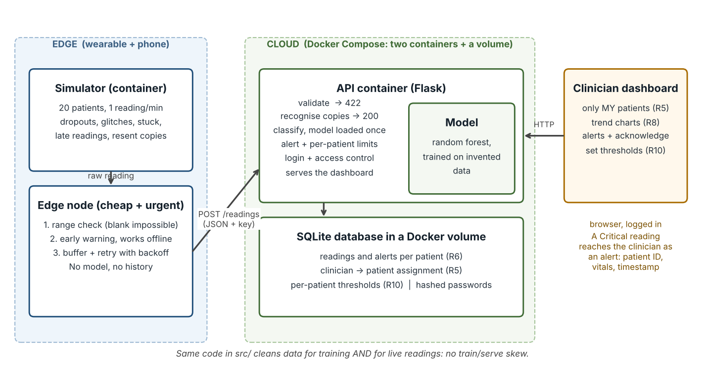
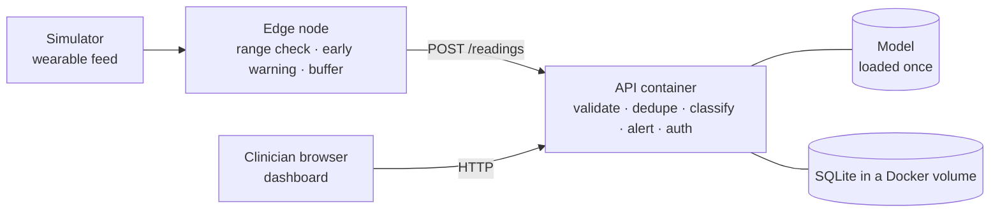

# Architecture

## What runs where
| Piece | Runs | Why there (evidence to cite) |
|---|---|---|
| Range check, early warning, buffer | **Edge** | Cheap, urgent, needs no history or model; keeps working offline |
| Validation, copy recognition | **Cloud API** | Needs the stored history (idempotency); protects the system whatever the client sends |
| Classification | **Cloud API** | Needs trend history and the model; the model is loaded once at start-up |
| History, alerts, thresholds | **Cloud DB (volume)** | Must survive restarts; one source of truth for every API copy |
| Dashboard | **Cloud API (same process)** | Prototype scale; see ADR 3 for why not separate services |

## Design choices you must justify (ADRs in `docs/adr/`)
1. Which model (ADR 1) · 2. Where to split edge and cloud (ADR 2) · 3. Monolith vs microservices, model loaded once, containers (ADR 3).

## Stateless API
The API keeps no readings in memory; everything is in the database. Two API copies would see the same history (tested).
